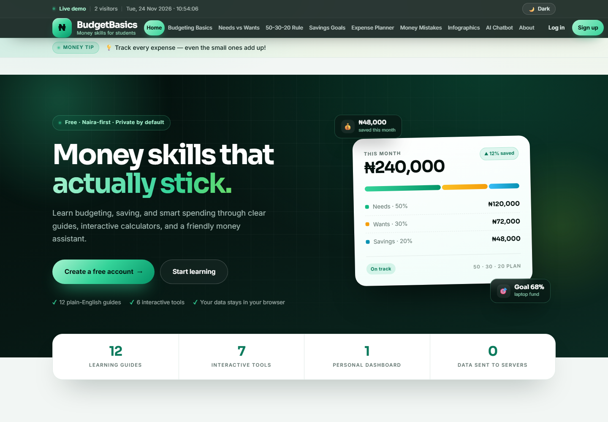
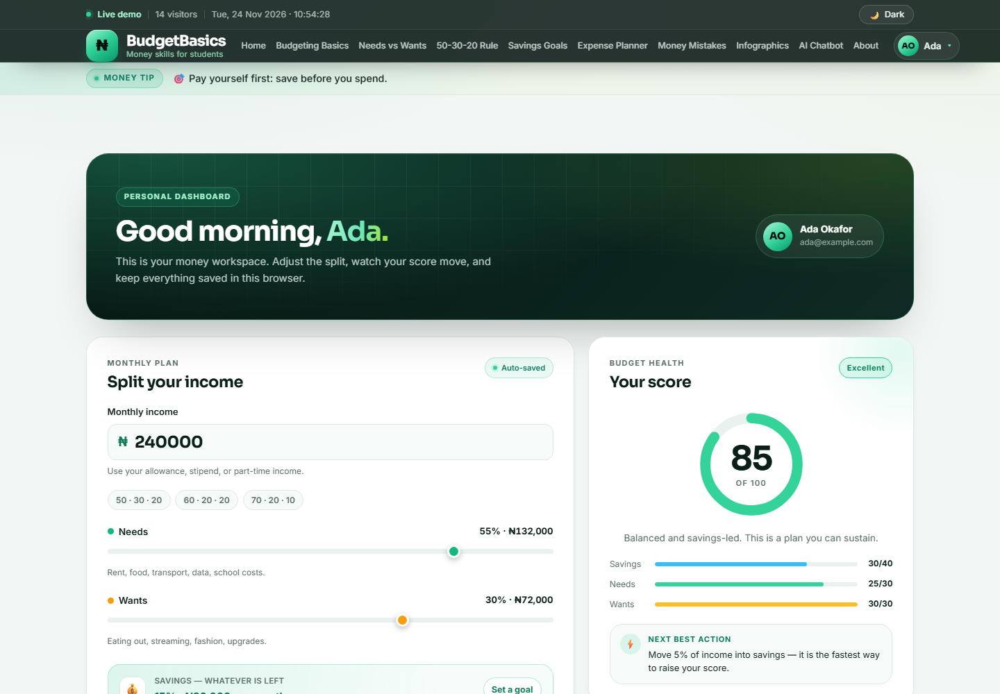
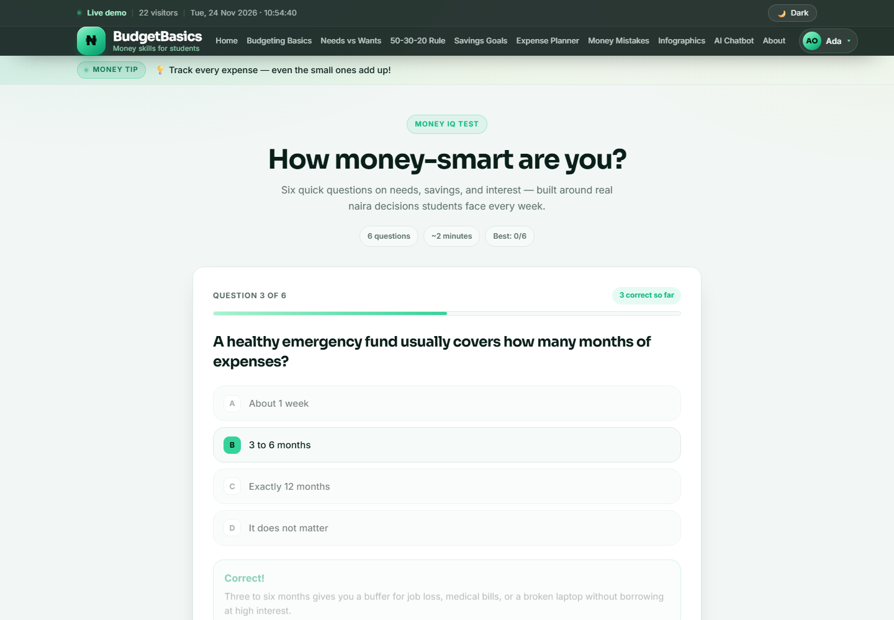
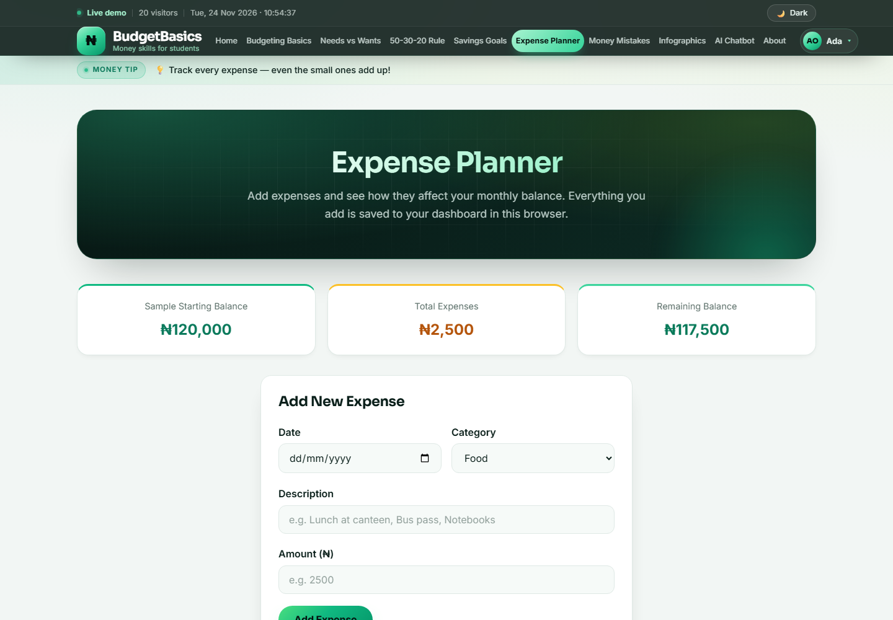

# BudgetBasics

**A Naira-first money workspace for students** — short lessons, working calculators, a scored personal dashboard, and a Money IQ quiz. Free, private, installable, and built entirely in the browser.


## Screenshots

| Home | Dashboard |
| --- | --- |
|  |  |

| Money IQ quiz | Expense planner |
| --- | --- |
|  |  |

## Why it exists

Most student budgeting content is abstract: dollars, percentages, and no memory of who you are. BudgetBasics translates all of it into naira, gives students a plan that scores itself, and keeps every byte of data on the device.

- **Naira-first** — every calculator, chart, and lesson speaks in ₦ via a single `Intl` formatter.
- **One next action** — the dashboard grades a plan out of 100 and surfaces the single move that would improve it.
- **Privacy as architecture** — no backend exists. Accounts, plans, expenses, and goals live in `localStorage`.
- **Momentum** — onboarding wizard, saving streaks, badges, demo data, and a six-question Money IQ quiz.

## Features

### Learn
- Clear guides for budgeting basics, needs vs wants, the 50-30-20 rule, and common money mistakes.
- Interactive classifiers, infographics, and a rule-based money assistant.
- Money IQ quiz with instant explanations, a review list, and a saved best score.

### Plan and track
- Monthly plan editor with 50-30-20 / 60-20-20 / 70-20-10 presets and live naira breakdowns.
- **Budget Health Score** (needs 30 + wants 30 + savings 40) with an animated ring, category breakdown, and next action.
- Category donut, six-month spending trend, and plain-English insight notes.
- What-if slider showing the score and yearly impact of moving wants into savings.
- Savings goals with progress, monthly timeline estimates, and per-account persistence.
- Expense planner with seven categories, live remaining balance, and delete controls.

### Stay engaged
- First-visit onboarding wizard (income → split → optional goal).
- Daily saving streak with a seven-day view.
- Nine badges across tracking, goals, budgeting, streaks, and the quiz.
- One-click demo data to explore a realistic student month.

### Own your data
- Export a JSON backup, restore it, or reset the account's data.
- Two-factor-free demo auth: salted SHA-256 password hashes, never plaintext.
- Installable PWA with an offline app shell via a service worker.
- Command palette (**Ctrl/Cmd + K**) for every page and action.

## Pages

| Route | What it does |
| --- | --- |
| `/` | Overview, live budget preview, feature grid, quiz teaser, dashboard teaser |
| `/budgeting-basics` | Core concepts and a sample student budget |
| `/needs-vs-wants` | Comparison, classifier quiz, buying decision guide |
| `/50-30-20` | Rule explanation and income-split calculator |
| `/savings-goals` | Goal planner with timeline estimates |
| `/expense-planner` | Expense tracking with a running balance |
| `/money-mistakes` | Common mistakes and fixes |
| `/infographics` | Visual summaries with category filters |
| `/chatbot` | Rule-based money assistant |
| `/money-iq` | Six-question quiz with saved best score |
| `/dashboard` | Protected workspace: plan, score, insights, streak, badges, tools |
| `/login`, `/signup` | Browser-only demo accounts |
| `/case-study` | Portfolio walkthrough of the product, design system, and architecture |
| `/about`, `/feedback`, `/contact`, `/sitemap` | Support and information |
| `*` | Custom 404 page |

## Tech stack

- **React 19** with Vite 8 and React Router 7 (nested layout route).
- **Plain CSS** with a design-token system and `[data-theme]` light/dark palettes.
- **Context + hooks** for auth and toasts; `useUserState` namespaces per-account storage.
- **PWA** — web manifest, maskable icons, and a cache-first service worker for static assets.
- **No runtime dependencies beyond React, Router, and the Google Fonts stylesheet.**

## Project structure

```
src/
  Components/        Header, footer, palette, toasts, charts, dashboard widgets
  context/           Auth and toast providers/contexts
  hooks/             useUserState, useCountUp
  pages/             One component + stylesheet per route
  utils/             currency, scoring, insights, streak, badges, demo data
public/
  icons/             PWA icons (192, 512; any + maskable)
  showcase/          Screenshots used by the README and case study
  manifest.webmanifest, sw.js, favicon set
```

## Accounts and data

Accounts are an explicit demo: **no server is contacted**. Creating an account stores a salted SHA-256 hash of the password in `localStorage` (never the plaintext), plus a per-account namespace for everything else:

- `bb_plan_<id>` — income and needs/wants split
- `bb_expenses_<id>` — tracked expenses
- `bb_savingsGoal_<id>` — goal and progress
- `bb_streak_<id>`, `bb_badges_<id>`, `bb_moneyIq_<id>` — habits and quiz best
- `bb_onboarding_<id>` — whether the setup wizard has been completed

Clearing site data, switching browsers, or using another device removes the account and its data. Backups (dashboard → Backup & explore) export the same shapes as JSON.

## Getting started

```bash
npm install
npm run dev
```

Open the URL printed by Vite (usually http://localhost:5173). Create any account — there are no shared credentials.

```bash
npm run lint      # ESLint
npm run build     # production build to dist/
npm run preview   # serve the production build (service worker active here)
```

The service worker only registers in production builds, so test installability and offline behaviour with `npm run preview`.

## Deployment

The app is a static SPA. Any static host works, as long as unknown routes fall back to `index.html`.

- **Vercel** — `vercel.json` is included with SPA rewrites and long-lived asset caching.
- **Netlify** — `netlify.toml` is included with build settings, SPA redirects, and header rules.
- **GitHub Pages / any CDN** — build with `npm run build` and add a catch-all rewrite to `/index.html`.

## Quality checks

- ESLint clean and production build verified (`npm run lint`, `npm run build`).
- End-to-end flows exercised in headless Chrome at desktop and mobile widths: signup, onboarding, plan editing, persistence, expense + goal tracking, streak check-in, badges, quiz completion, command palette, case study, PWA manifest, protected routes, logout/login, and the 404 page — with zero console errors.
- Layout checked for horizontal overflow at 1440px and 390px.

## License

MIT © 2026 [zeemy777](https://github.com/zeemy777). See [LICENSE](LICENSE).
